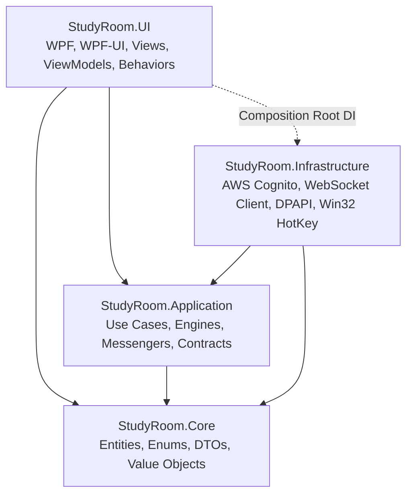
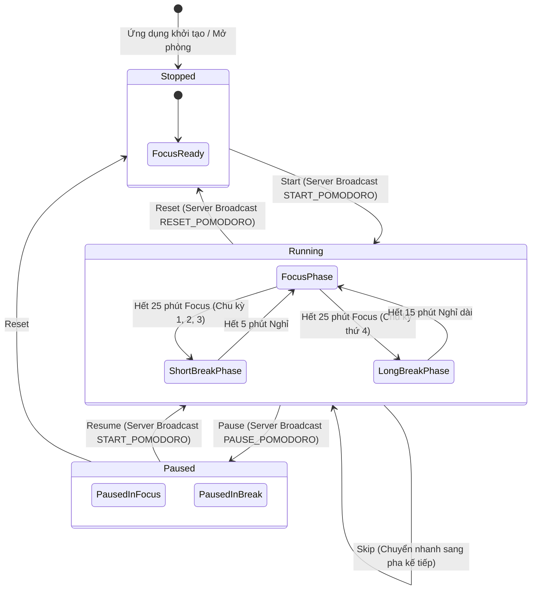

# ARCHITECTURE & SYSTEM BLUEPRINT: StudyRoom Desktop App

> **Tài liệu kiến trúc hệ thống chuẩn mực dành cho Vibe Coding & AI Agent Execution**  
> **Phiên bản:** 2.0  
> **Mục tiêu:** Cung cấp đầy đủ hợp đồng (interfaces), cấu trúc dữ liệu, máy trạng thái (state machines), và quy chuẩn luồng để AI Agent có thể sinh mã chính xác 100% không cần suy diễn.

---

## 1. ARCHITECTURAL OVERVIEW

StudyRoom tuân thủ nghiêm ngặt **Clean Architecture kết hợp Strict MVVM (Model-View-ViewModel)** trên nền tảng **C# 12 / .NET 8 WPF**:



### Nguyên tắc bất biến (Inviolable Rules):
1. **Dependency Rule:** Tầng `Core` là trung tâm, không phụ thuộc vào bất kỳ tầng nào. `Application` chỉ phụ thuộc `Core`. `Infrastructure` và `UI` phụ thuộc `Core` và `Application`.
2. **Strict MVVM Separation:** View (.xaml, .xaml.cs) chỉ phục vụ hiển thị và tương tác Windows (như Win32 Hwnd Hook). Tuyệt đối **không** chứa business logic. ViewModel **không** import `System.Windows.*`.
3. **Decoupled Messaging:** Các ViewModel tuyệt đối không giữ tham chiếu trực tiếp đến nhau. Mọi giao tiếp liên ViewModel dùng `CommunityToolkit.Mvvm.Messaging.WeakReferenceMessenger`.
4. **Thread Safety & UI Dispatching:** Mọi cập nhật dữ liệu đẩy từ Background Thread (WebSocket, Timers) lên `ObservableCollection` hoặc thuộc tính binding phải đi qua `IDispatcherService`.

---

## 2. DIRECTORY TREE STRUCTURE

```
StudyRoom.sln
│
├── src/
│   ├── StudyRoom.Core/                         # Class Library (.NET 8) - Domain Entities & Contracts
│   │   ├── Common/
│   │   │   └── Result.cs                       # Result<T> pattern cho kết quả xử lý
│   │   ├── Entities/
│   │   │   ├── User.cs                         # Người dùng hệ thống
│   │   │   ├── StudyGroup.cs                   # Thông tin phòng học, Host, chế độ điều khiển
│   │   │   ├── Member.cs                       # Thành viên trong phòng (Host / Member)
│   │   │   ├── KanbanCard.cs                   # Thẻ Kanban (CardId, Title, ColumnId, Rank)
│   │   │   ├── Flashcard.cs                    # Thẻ học (CardId, Question, Answer)
│   │   │   └── PomodoroSession.cs              # Trạng thái phiên Pomodoro
│   │   ├── Enums/
│   │   │   ├── PomodoroPhase.cs                # Focus, ShortBreak, LongBreak
│   │   │   ├── TimerState.cs                   # Stopped, Running, Paused
│   │   │   ├── ControlMode.cs                  # HostOnly, Equal
│   │   │   ├── MemberRole.cs                   # Host, Member
│   │   │   └── KanbanColumn.cs                 # Todo, InProgress, Done
│   │   ├── Interfaces/
│   │   │   ├── IAuthService.cs                 # Xác thực Amazon Cognito
│   │   │   ├── ISecureStorageService.cs        # Lưu trữ DPAPI an toàn
│   │   │   ├── IWebSocketClient.cs             # Kết nối realtime WebSocket
│   │   │   ├── IPomodoroEngine.cs              # Động cơ đếm lùi chính xác (PeriodicTimer)
│   │   │   ├── IRateLimiter.cs                 # Giới hạn tần suất Token Bucket
│   │   │   ├── IHotKeyService.cs               # Đăng ký phím tắt Win32 toàn cục
│   │   │   ├── IStudyRoomApiClient.cs          # Gọi REST API (GET/POST groups)
│   │   │   ├── IDispatcherService.cs           # Điều phối thread về WPF UI Dispatcher
│   │   │   ├── INavigationService.cs           # Điều hướng màn hình/Window
│   │   │   └── IFractionalIndexingHelper.cs    # Thuật toán tính Rank Kanban
│   │   └── Models/
│   │       ├── AuthSession.cs                  # DTO phiên đăng nhập lưu DPAPI
│   │       ├── AuthTokens.cs                   # DTO lưu AccessToken, IdToken, RefreshToken
│   │       ├── WebSocketMessage.cs             # DTO gói tin chuẩn WebSocket
│   │       ├── PomodoroSyncPayload.cs          # DTO payload POMODORO_SYNC
│   │       └── ChatMessage.cs                  # DTO tin nhắn chat tức thời
│   │
│   ├── StudyRoom.Application/                  # Class Library (.NET 8) - Business Logic & Engines
│   │   ├── Engines/
│   │   │   ├── PomodoroEngine.cs               # PeriodicTimer 200ms + Drift Compensation
│   │   │   └── TokenBucketRateLimiter.cs       # Token Bucket (5 tokens, 1 token/sec)
│   │   ├── Helpers/
│   │   │   └── FractionalIndexingHelper.cs     # Xử lý rank chèn thẻ và rebalance
│   │   ├── Messages/                           # WeakReferenceMessenger Messages
│   │   │   ├── PhaseChangedMessage.cs          # Chuyển pha Focus <-> Break
│   │   │   ├── CardMovedMessage.cs             # Thẻ Kanban đổi cột/vị trí
│   │   │   ├── BatonPassedMessage.cs           # Quyền điều khiển Pomodoro chuyển giao
│   │   │   ├── ChatMessageReceivedMessage.cs   # Tin nhắn chat mới tới
│   │   │   └── PresenceChangedMessage.cs       # Thành viên vào/rời phòng
│   │   └── Services/
│   │       ├── GroupSessionManager.cs          # Quản lý trạng thái phiên phòng học
│   │       └── FlashcardReviewManager.cs       # Điều phối rút thẻ kiểm tra ngẫu nhiên
│   │
│   ├── StudyRoom.Infrastructure/               # Class Library (.NET 8) - External Systems
│   │   ├── Auth/
│   │   │   └── CognitoAuthService.cs           # Triển khai AWSSDK.CognitoIdentityProvider
│   │   ├── Security/
│   │   │   └── DpapiSecureStorageService.cs    # Triển khai ProtectedData Windows DPAPI
│   │   ├── Network/
│   │   │   ├── WebSocketClient.cs              # ClientWebSocket kèm Auto-reconnect & Heartbeat
│   │   │   └── StudyRoomApiClient.cs           # HttpClient gọi REST API qua IHttpClientFactory
│   │   ├── Storage/
│   │   │   └── SqliteLocalCacheRepository.cs   # SQLite lưu cache offline (%LocalAppData%)
│   │   └── OS/
│   │       └── Win32HotKeyService.cs           # P/Invoke RegisterHotKey/UnregisterHotKey
│   │
│   └── StudyRoom.UI/                           # WPF Application (.NET 8-windows)
│       ├── App.xaml / App.xaml.cs              # DI Bootstrapper, Global Exception Handlers
│       ├── Controls/
│       │   ├── KanbanColumnControl.xaml(.cs)   # Cột thẻ Kanban
│       │   └── PomodoroClockControl.xaml(.cs)  # Đồng hồ đếm lùi tròn (Radial Progress)
│       ├── Converters/
│       │   ├── BooleanToVisibilityConverter.cs
│       │   ├── PhaseToBrushConverter.cs        # Focus (#2563EB) <-> Break (#D97706)
│       │   └── RoleToVisibilityConverter.cs    # Ẩn nút nếu không có quyền điều khiển
│       ├── Behaviors/
│       │   └── KanbanDragDropBehavior.cs       # Xử lý sự kiện kéo thả thẻ
│       ├── Services/
│       │   ├── WpfDispatcherService.cs         # Triển khai IDispatcherService
│       │   └── WindowNavigationService.cs      # Triển khai INavigationService
│       ├── Views/
│       │   ├── MainWindow.xaml(.cs)            # Cửa sổ chính FluentWindow, HwndSource Hook
│       │   ├── LoginView.xaml(.cs)             # Màn hình đăng nhập / đăng ký
│       │   ├── DashboardView.xaml(.cs)         # Màn hình chọn phòng / tạo phòng
│       │   ├── StudyRoomView.xaml(.cs)         # Không gian phòng học chính
│       │   ├── FloatingBubbleView.xaml(.cs)    # Cửa sổ bong bóng nổi (Topmost, trong suốt)
│       │   ├── FullChatView.xaml(.cs)          # Khung chat lớn tự bung trong pha Break
│       │   └── FlashcardDialog.xaml(.cs)       # Pop-up câu hỏi kiểm tra chéo 3D
│       └── ViewModels/
│           ├── ViewModelBase.cs                # Base class hỗ trợ IsBusy, Title
│           ├── MainViewModel.cs                # Shell điều phối và nhận Win32 Message
│           ├── LoginViewModel.cs
│           ├── DashboardViewModel.cs
│           ├── StudyRoomViewModel.cs
│           ├── PomodoroViewModel.cs
│           ├── KanbanViewModel.cs
│           ├── FloatingBubbleViewModel.cs
│           ├── FullChatViewModel.cs
│           └── FlashcardViewModel.cs
│
└── tests/
    ├── StudyRoom.Application.Tests/
    │   ├── PomodoroEngineTests.cs
    │   ├── TokenBucketRateLimiterTests.cs
    │   ├── FractionalIndexingTests.cs
    │   └── FlashcardReviewManagerTests.cs
    └── StudyRoom.UI.Tests/
        ├── LoginViewModelTests.cs
        ├── MainViewModelTests.cs
        ├── PomodoroViewModelTests.cs
        └── KanbanViewModelTests.cs
```

---

## 3. CORE INTERFACES & CONTRACTS (BẢN ĐẶC TẢ HỢP ĐỒNG C#)

Dưới đây là các Interface chuẩn mực được đặt trong `StudyRoom.Core/Interfaces/`. AI Agent khi sinh mã phải tuân thủ chính xác chữ ký phương thức:

### 3.1. Xác thực & Bảo mật (Auth & Security)

```csharp
namespace StudyRoom.Core.Interfaces;

public interface IAuthService
{
    Task<Result<AuthTokens>> LoginAsync(string email, string password, CancellationToken cancellationToken = default);
    Task<Result<bool>> RegisterAsync(string email, string password, string displayName, CancellationToken cancellationToken = default);
    Task<Result<AuthTokens>> RefreshTokenAsync(string refreshToken, CancellationToken cancellationToken = default);
    Task LogoutAsync(CancellationToken cancellationToken = default);
}

public interface ISecureStorageService
{
    Task SaveSessionAsync(AuthSession session, CancellationToken cancellationToken = default);
    Task<AuthSession?> LoadSessionAsync(CancellationToken cancellationToken = default);
    Task ClearSessionAsync(CancellationToken cancellationToken = default);
}
```

### 3.2. Mạng & Thời gian thực (Network & Real-time)

```csharp
namespace StudyRoom.Core.Interfaces;

public interface IWebSocketClient : IAsyncDisposable
{
    bool IsConnected { get; }
    event Func<WebSocketMessage, Task>? MessageReceived;
    event Func<Exception?, Task>? Disconnected;

    Task ConnectAsync(Uri serverUri, string accessToken, CancellationToken cancellationToken = default);
    Task SendAsync(WebSocketMessage message, CancellationToken cancellationToken = default);
    Task DisconnectAsync(CancellationToken cancellationToken = default);
}

public interface IStudyRoomApiClient
{
    Task<Result<StudyGroup>> CreateGroupAsync(string groupName, ControlMode controlMode, int focusMinutes, int breakMinutes, CancellationToken cancellationToken = default);
    Task<Result<StudyGroup>> GetGroupAsync(string groupId, CancellationToken cancellationToken = default);
    Task<Result<bool>> JoinGroupAsync(string groupId, CancellationToken cancellationToken = default);
}
```

### 3.3. Động cơ Pomodoro & Thuật toán (Engines & Helpers)

```csharp
namespace StudyRoom.Core.Interfaces;

public interface IPomodoroEngine : IDisposable
{
    PomodoroSession CurrentSession { get; }
    event Action<PomodoroSession>? Tick;
    event Action<PomodoroSession>? PhaseCompleted;

    void SyncFromServer(DateTimeOffset? targetEndTimeUtc, PomodoroPhase phase, TimerState state);
    void Start();
    void Pause();
    void Resume();
    void Reset();
    void SkipPhase();
    void PassBaton(string newHolderUserId);
    bool CanControl(string currentUserId, StudyGroup group);
}

public interface IRateLimiter
{
    bool TryAcquire();
    TimeSpan GetRetryAfter();
}

public interface IFractionalIndexingHelper
{
    double CalculateNewRank(double? prevRank, double? nextRank);
    bool NeedsRebalance(IEnumerable<double> ranks);
    List<double> Rebalance(int count);
}
```

### 3.4. Hệ điều hành & UI (OS Interop & Presentation Services)

```csharp
namespace StudyRoom.Core.Interfaces;

public interface IHotKeyService : IDisposable
{
    bool RegisterHotKey(IntPtr windowHandle, int hotKeyId, uint modifiers, uint virtualKey);
    bool UnregisterHotKey(IntPtr windowHandle, int hotKeyId);
}

public interface IDispatcherService
{
    Task InvokeAsync(Action action);
    Task<T> InvokeAsync<T>(Func<T> function);
}

public interface INavigationService
{
    void NavigateTo<TViewModel>() where TViewModel : class;
    void OpenDialog<TDialogViewModel>() where TDialogViewModel : class;
    void CloseCurrentDialog();
}
```

---

## 4. IN-PROCESS MESSAGING (WEAK REFERENCE MESSENGER CONTRACTS)

Các bản tin trao đổi liên ViewModel thông qua `WeakReferenceMessenger.Default` được định nghĩa trong `StudyRoom.Application/Messages/`:

```csharp
namespace StudyRoom.Application.Messages;

// Phát khi Pomodoro chuyển trạng thái Focus <-> Break
public sealed record PhaseChangedMessage(PomodoroPhase NewPhase, int DurationSeconds);

// Phát khi có thẻ Kanban đổi vị trí/cột
public sealed record CardMovedMessage(string CardId, KanbanColumn NewColumn, double NewRank);

// Phát khi Host nhượng quyền điều khiển Pomodoro cho thành viên khác
public sealed record BatonPassedMessage(string NewHostUserId);

// Phát khi có tin nhắn chat mới nhận từ WebSocket
public sealed record ChatMessageReceivedMessage(ChatMessage Message);

// Phát khi thành viên gia nhập hoặc rời phòng
public sealed record PresenceChangedMessage(string UserId, string DisplayName, bool IsOnline);
```

---

## 5. POMODORO STATE MACHINE & PHASE TRANSITION SPECIFICATION



### Bảng chuyển đổi trạng thái (State Transition Table):

| Trạng thái hiện tại | Sự kiện kích hoạt | Điều kiện quyền | Trạng thái tiếp theo | Hành động hệ thống |
|---|---|---|---|---|
| `Stopped` | `Start` | Host / Baton / Equal | `Running (Focus)` | Server tính `TargetEndTimeUtc`, phát `POMODORO_SYNC`. Client kích hoạt `PeriodicTimer`. |
| `Running` | `Pause` | Host / Baton / Equal | `Paused` | Ghi nhận thời gian còn lại, dừng timer server/client. |
| `Paused` | `Resume` | Host / Baton / Equal | `Running` | Tính lại `TargetEndTimeUtc = UtcNow + Remaining`, phát sync. |
| `Running (Focus)` | `Remaining == 0` | Tự động | `Running (ShortBreak)` | Đổi màu UI sang Vàng ấm (`#D97706`), bung Full Chat, phát chuông. |
| `Running (Focus)` (Chu kỳ 4) | `Remaining == 0` | Tự động | `Running (LongBreak)` | Bung Full Chat, gợi ý Flashcard ôn tập nhóm. |
| `Running (Break)` | `Remaining == 0` | Tự động | `Running (Focus)` | Đổi màu UI sang Xanh dịu (`#2563EB`), thu nhỏ Chat, tiếp tục đếm. |
| Bất kỳ | `PassBaton` | Chỉ Host | Không đổi | Server cập nhật `CurrentHostId`, broadcast `BatonPassedMessage`. |

---

## 6. THREADING MODEL & DISPATCHER PATTERN

WPF yêu cầu mọi thay đổi trên các thành phần UI hoặc `ObservableCollection` phải diễn ra trên UI Thread. Do gói tin WebSocket được nhận trên thread ngầm của OS Socket pool, quy trình điều phối chuẩn như sau:

```csharp
// Chuẩn mực xử lý tin nhắn WebSocket tại ViewModel hoặc Service:
private async Task HandleIncomingMessageAsync(WebSocketMessage message)
{
    switch (message.Action)
    {
        case "CARD_MOVED":
            var payload = JsonSerializer.Deserialize<CardMovedPayload>(message.Data.ToString()!);
            
            // BẮT BUỘC: Điều phối cập nhật ObservableCollection về UI Dispatcher
            await _dispatcherService.InvokeAsync(() =>
            {
                var card = Cards.FirstOrDefault(c => c.CardId == payload.CardId);
                if (card != null)
                {
                    card.ColumnId = payload.NewColumn;
                    card.Rank = payload.NewRank;
                    SortCards();
                }
            });
            break;
    }
}
```

---

## 7. DEPENDENCY REGISTRATION & COMPOSITION ROOT

Toàn bộ dịch vụ được đăng ký tại `App.xaml.cs` theo chuẩn Generic Host hoặc `ServiceCollection`:

```csharp
public static void ConfigureServices(IServiceCollection services)
{
    // 1. Core Services (Singletons)
    services.AddSingleton<IDispatcherService, WpfDispatcherService>();
    services.AddSingleton<INavigationService, WindowNavigationService>();
    services.AddSingleton<ISecureStorageService, DpapiSecureStorageService>();
    services.AddSingleton<IAuthService, CognitoAuthService>();
    services.AddSingleton<IWebSocketClient, WebSocketClient>();
    services.AddSingleton<IPomodoroEngine, PomodoroEngine>();
    services.AddSingleton<IHotKeyService, Win32HotKeyService>();
    services.AddSingleton<IFractionalIndexingHelper, FractionalIndexingHelper>();

    // 2. HTTP API Client
    services.AddHttpClient<IStudyRoomApiClient, StudyRoomApiClient>();

    // 3. ViewModels (Transient)
    services.AddTransient<MainViewModel>();
    services.AddTransient<LoginViewModel>();
    services.AddTransient<DashboardViewModel>();
    services.AddTransient<StudyRoomViewModel>();
    services.AddTransient<PomodoroViewModel>();
    services.AddTransient<KanbanViewModel>();
    services.AddTransient<FloatingBubbleViewModel>();
    services.AddTransient<FullChatViewModel>();
    services.AddTransient<FlashcardViewModel>();

    // 4. Views & Dialogs (Transient)
    services.AddTransient<MainWindow>();
    services.AddTransient<FloatingBubbleView>();
    services.AddTransient<FlashcardDialog>();
}
```

---

## 8. APPROVED DEPENDENCIES & ANTI-PATTERNS

### 8.1. Approved NuGet Packages:
- `CommunityToolkit.Mvvm` (`>= 8.3.0`): MVVM Source Generator & In-process Messaging.
- `WPF-UI` (`>= 4.0.0`): Giao diện Fluent Design hiện đại, mượt mà trên Windows 10/11.
- `Microsoft.Extensions.DependencyInjection` (`>= 8.0.0`): IoC Container chuẩn .NET.
- `AWSSDK.CognitoIdentityProvider` (`>= 3.7.0`): Xác thực AWS Cognito.
- `System.Security.Cryptography.ProtectedData` (`>= 8.0.0`): Windows DPAPI.
- `System.Text.Json` (`>= 8.0.0`): High-performance JSON serializer.
- `xunit`, `Moq`, `FluentAssertions`: Kiểm thử phần mềm.

### 8.2. Anti-Patterns & Banned Implementations (CẤM):
- ❌ **CẤM** sử dụng Electron, Chromium Embedded Framework (CEFSharp), hoặc WebView2 để render giao diện chính (ứng dụng phải thuần 100% Native WPF).
- ❌ **CẤM** gọi `.Result` hoặc `.Wait()` trên bất kỳ `Task` nào trong code UI và ViewModel để triệt tiêu nguy cơ Deadlock.
- ❌ **CẤM** lưu trữ token hoặc mật khẩu dưới dạng plaintext trong file `.json`, `.txt`, `.xml` hoặc Windows Registry.
- ❌ **CẤM** viết code xử lý nghiệp vụ, gọi API hoặc timer bên trong Code-behind (`.xaml.cs`).
- ❌ **CẤM** tạo timer đếm lùi bằng `Thread.Sleep()` hoặc vòng lặp `while(true)` gây treo giao diện.
