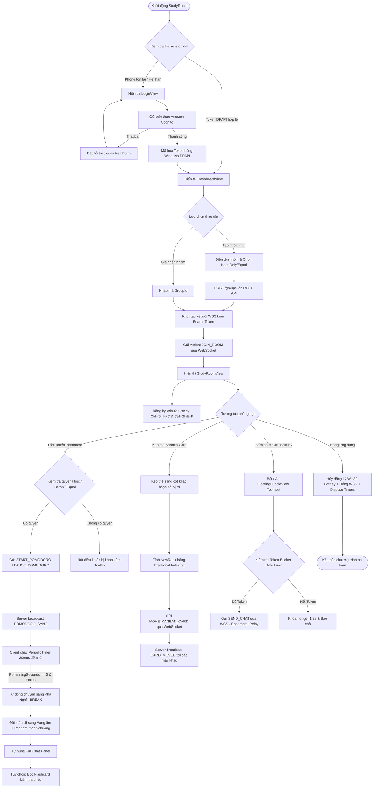

# PRODUCT REQUIREMENTS DOCUMENT (PRD): StudyRoom Desktop App

> **Tài liệu đặc tả yêu cầu sản phẩm dành cho Vibe Coding & AI Agent Execution**  
> **Phiên bản:** 2.0  
> **Nền tảng:** Windows 10/11 (x64) · .NET 8 (LTS) · WPF Native (WPF-UI) · AWS Serverless  

---

## 1. TỔNG QUAN SẢN PHẨM & MỤC TIÊU DỰ ÁN

### 1.1. Tuyên bố sản phẩm (Product Vision)
**StudyRoom** là ứng dụng máy tính (Desktop App) bản địa trên Windows, đóng vai trò là không gian học tập số cộng tác (Digital Group Study Workspace) thời gian thực dành cho học sinh, sinh viên và các nhóm nghiên cứu từ xa. 

StudyRoom giải quyết triệt để vấn đề xao nhãng và thiếu kết nối khi tự học trực tuyến thông qua:
1. **Đồng hồ Pomodoro đồng bộ có thẩm quyền từ máy chủ (Authoritative Real-time Pomodoro)** đảm bảo cả nhóm cùng học và cùng nghỉ theo chu kỳ chính xác.
2. **Bảng công việc Kanban phân cấp (Collaborative Kanban Board)** hỗ trợ phân chia nhiệm vụ mượt mà bằng thuật toán Fractional Indexing.
3. **Bong bóng chat nổi trên màn hình (Floating Bubble Overlay)** gọi bằng phím tắt Win32 toàn cục (`Ctrl + Shift + C`), cho phép gửi tin nhắn nhanh mà không cần chuyển cửa sổ làm việc (alt-tab), hạn chế đứt gãy luồng tập trung.
4. **Bộ thẻ Flashcard kiểm tra chéo (Group Flashcards)** tự động kích hoạt trong giờ giải lao để ôn tập kiến thức nhóm.

### 1.2. Mục tiêu kỹ thuật & Trải nghiệm (Technical & UX Goals)
- **100% Native WPF trên .NET 8:** Tận dụng tối đa hiệu năng Windows, UI hiện đại qua `WPF-UI`, mức tiêu hao RAM chế độ nền < 80MB (không dùng Electron/CEF).
- **Zero-Latency Feel:** Động cơ đếm lùi độc lập tại client dùng `PeriodicTimer` (chu kỳ 200ms) khử hoàn toàn độ trễ hiển thị; độ lệch thời gian giữa các máy < 500ms.
- **Bảo mật bản địa:** Tuyệt đối không lưu plaintext token; mã hóa phiên làm việc bằng **Windows DPAPI** (`ProtectedData.Protect` theo user Windows hiện tại).
- **Ephemeral Real-time Communication:** Tin nhắn chat trao đổi tức thời trực tiếp qua WebSocket memory relay, không lưu vào database để đảm bảo tốc độ và tiết kiệm chi phí.

---

## 2. CORE FEATURES (ĐẶC TẢ TÍNH NĂNG CỐT LÕI)

```
┌────────────────────────────────────────────────────────────────────────┐
│                        STUDYROOM CORE MODULES                          │
├──────────────────┬──────────────────┬──────────────────┬───────────────┤
│ 1. Auth & DPAPI  │ 2. Room & Baton  │ 3. Pomodoro Hub  │ 4. Kanban     │
│  - Cognito Auth  │  - Host-Only     │  - Authoritative │  - 3 Columns  │
│  - DPAPI Token   │  - Equal Mode    │  - Drift Check   │  - Drag & Drop│
│  - Auto-login    │  - Pass Baton    │  - Offline Safe  │  - Frac Rank  │
├──────────────────┴──────────────────┴──────────────────┴───────────────┤
│ 5. Ephemeral Chat & Overlay         │ 6. Group Flashcards              │
│  - Floating Bubble (Ctrl+Shift+C)   │  - Shared Room Deck              │
│  - Token Bucket Rate Limiter        │  - Break-time Random Challenge   │
│  - Auto-expand in Break Phase       │  - Instant Peer Review           │
└────────────────────────────────────────────────────────────────────────┘
```

### 2.1. Xác thực & Quản lý Danh tính (Authentication & Security)
- **Cơ chế xác thực:** Tích hợp với Amazon Cognito User Pool qua Client ID (không dùng Client Secret).
- **Lưu trữ phiên an toàn (DPAPI):**
  - Khi đăng nhập thành công, lưu bundle gồm `UserId`, `Email`, `IdToken`, `AccessToken`, `RefreshToken`, `ExpiresAtUtc` vào `%LocalAppData%\StudyRoom\session.dat`.
  - Dữ liệu được mã hóa bằng `ProtectedData.Protect(..., DataProtectionScope.CurrentUser)`.
  - Khi khởi động ứng dụng: đọc `session.dat`, giải mã bằng DPAPI; nếu token còn hạn thì tự động vào Dashboard, nếu hết hạn thì chuyển sang LoginView.
- **Trạng thái UI:**
  - Nút bấm Submit tự động disable và hiển thị Loading state trong suốt quá trình xác thực.
  - Xử lý thông báo lỗi người dùng rõ ràng (Sai mật khẩu, Email chưa xác thực, Mất mạng).

### 2.2. Không gian Phòng học & Mô hình Phân quyền (Study Group & Permissions)
- **Tạo & Gia nhập phòng:**
  - Tạo phòng: Người dùng chỉ định `GroupName`, chế độ điều khiển `ControlMode` (`HOST_ONLY` hoặc `EQUAL`), thời lượng `FocusDuration` (mặc định 25 phút) và `BreakDuration` (mặc định 5 phút).
  - Gia nhập phòng: Nhập mã `GroupId` gồm chuỗi định danh duy nhất.
- **Mô hình kiểm soát Pomodoro (Control Modes):**
  - **Host-Only Mode:** Chỉ Trưởng nhóm (`HostUserId`) hoặc người đang giữ quyền (`BatonHolderUserId`) mới có quyền kích hoạt lệnh Start / Pause / Resume / Skip chu kỳ Pomodoro. Nút bấm trên UI của các thành viên khác chuyển sang trạng thái disabled kèm tooltip giải thích.
  - **Equal Mode:** Tất cả thành viên trong nhóm đều có quyền điều khiển chu kỳ Pomodoro.
- **Cơ chế nhường quyền (Pass the Baton):**
  - Trưởng nhóm có thể chọn bất kỳ thành viên nào trong danh sách đang online để chuyển giao quyền điều khiển (`PASS_BATON`).
  - Khi nhận quyền, giao diện người nhận lập tức kích hoạt các nút điều khiển.

### 2.3. Động cơ Pomodoro Đồng bộ Thời gian thực (Authoritative Precision Timer)
- **Mô hình Server-Authoritative:**
  - Server (AWS Lambda / DynamoDB) tính toán mốc kết thúc tuyệt đối: `TargetEndTimeUtc = UtcNow + Duration`.
  - Server phát bản tin `POMODORO_SYNC` chứa `TargetEndTimeUtc`, `Phase` (`Focus`, `ShortBreak`, `LongBreak`), `State` (`Running`, `Paused`).
- **Client Precision Countdown Engine:**
  - Client tính thời gian còn lại: `RemainingSeconds = Math.Max(0, (int)(TargetEndTimeUtc - DateTimeOffset.UtcNow).TotalSeconds)`.
  - Sử dụng `System.Threading.PeriodicTimer` với chu kỳ **200ms** (không dùng `DispatcherTimer` 1000ms để tránh sai số lũy kế).
- **Bù trôi thời gian (Clock Drift Correction):**
  - Mỗi khi nhận `POMODORO_SYNC`, client đối soát `RemainingSeconds` cục bộ với mốc của server; nếu lệch > 500ms thì tự động hiệu chỉnh êm (smooth adjust).
- **Khả năng hoạt động khi mất kết nối (Offline Resilient):**
  - Nếu mất mạng đột ngột trong lúc Pomodoro đang chạy, đồng hồ client **tiếp tục đếm lùi chính xác** tới `TargetEndTimeUtc`.
  - Khi mạng khôi phục, client gửi `GET /groups/{id}` để đối soát lại trạng thái mới nhất từ server.
- **Hiển thị trực quan theo pha:**
  - Pha Học (`Focus`): Tông màu chủ đạo Xanh dịu mắt (`#2563EB`), bật chế độ chống xao nhãng.
  - Pha Nghỉ (`ShortBreak` / `LongBreak`): Tông màu Vàng ấm (`#D97706`), phát âm thanh chuông báo và tự động bung khung chat.

### 2.4. Bảng Công Việc Nhóm (Collaborative Kanban Board)
- **Cấu trúc cột:** Gồm 3 cột chuẩn: `TODO` (Cần làm), `IN_PROGRESS` (Đang làm), `DONE` (Hoàn thành).
- **Kéo thả mượt mà (Drag & Drop):** Kéo thả thẻ giữa các cột và sắp xếp thứ tự các thẻ trong cùng một cột thông qua WPF-UI Card và Drop Behavior.
- **Thuật toán Fractional Indexing:**
  - Mỗi thẻ sở hữu trọng số thứ tự `Rank` kiểu `double`.
  - Khi kéo thẻ vào giữa Card A (`Rank: a`) và Card B (`Rank: b`): `NewRank = (a + b) / 2.0`.
  - Chèn đầu: `NewRank = firstRank / 2.0`.
  - Chèn cuối: `NewRank = lastRank + 1.0`.
  - Danh sách rỗng: `NewRank = 1.0`.
  - **Tự động cân bằng (Rebalance):** Nếu khoảng cách `|a - b| < 1e-6`, client kích hoạt phân bổ lại toàn bộ rank trong cột (`1.0, 2.0, 3.0, ...`) để tránh tràn số thực.
- **Đồng bộ thời gian thực:** Ngay khi thả chuột, client phát `MOVE_KANBAN_CARD` qua WebSocket. Các máy khác nhận sự kiện `CARD_MOVED` và dịch chuyển thẻ lập tức.

### 2.5. Giao tiếp Linh hoạt & Bong bóng Nổi (Ephemeral Chat & Floating Overlay)
- **Bong bóng chat nổi (Floating Bubble Window):**
  - Cửa sổ WPF độc lập: `Topmost = true`, `AllowsTransparency = true`, `WindowStyle = WindowStyle.None`.
  - Phím tắt toàn cục: `Ctrl + Shift + C` đăng ký qua Win32 API (`RegisterHotKey`). Bấm tại bất kỳ đâu trên Windows đều gọi/ẩn bong bóng.
  - Cho phép người dùng kéo thả bong bóng (`DragMove()`) tới vị trí mong muốn trên màn hình.
- **Khung Chat đầy đủ (Full Chat Panel):**
  - Tự động bung ra khi chuyển sang pha `ShortBreak` hoặc `LongBreak`.
  - Tự động thu gọn vào thanh công cụ khi chuyển sang pha `Focus`.
- **Chống spam bằng Token Bucket (Client-Side Rate Limiting):**
  - Dung lượng bucket: 5 tokens. Tốc độ nạp: 1 token / giây.
  - Mỗi tin nhắn gửi đi tiêu tốn 1 token. Nếu hết token, vô hiệu hóa nút gửi trong thời gian chờ nạp lại và thông báo "Gửi quá nhanh, vui lòng đợi!".
- **Bản chất dữ liệu:** Tin nhắn chat là **Ephemeral Relay**, phát sóng trực tiếp qua kết nối WebSocket trong RAM của server, **hoàn toàn không lưu trữ trong database**.

### 2.6. Thẻ Ôn tập Nhóm (Group Flashcards)
- **Quản lý bộ thẻ:** Mỗi phòng có một danh sách Flashcards gồm `Question` và `Answer`.
- **Thử thách ngẫu nhiên trong giờ nghỉ:**
  - Trong pha Nghỉ ngơi, thành viên có thể bấm "Thử thách Flashcard".
  - Backend bốc ngẫu nhiên 1 câu hỏi từ phòng và phát sóng `FLASHCARD_PROMPT` tới tất cả thành viên.
  - Giao diện client hiển thị hộp thoại pop-up dạng thẻ 3D lật mặt trước (câu hỏi) và mặt sau (đáp án).

---

## 3. USER FLOW TOÀN HỆ THỐNG



---

## 4. USER STORIES & ACCEPTANCE CRITERIA (GHERKIN FORMAT)

### US-01: Phiên Đăng Nhập An Toàn & Tự Động Đăng Nhập (DPAPI)
- **Mô tả:** Là người dùng, tôi muốn lưu phiên đăng nhập an toàn để không phải nhập lại mật khẩu mỗi lần mở máy.
- **Tiêu chí chấp nhận (Acceptance Criteria):**
  - **Scenario 1.1:** Đăng nhập thành công và mã hóa token
    - *Given* người dùng nhập đúng email và mật khẩu tại `LoginView`
    - *When* bấm nút "Đăng nhập"
    - *Then* ứng dụng gọi Cognito xác thực, mã hóa `AuthSession` bằng `ProtectedData.Protect` với `DataProtectionScope.CurrentUser` và lưu vào `%LocalAppData%\StudyRoom\session.dat`
    - *And* file trên đĩa không chứa bất kỳ chuỗi token nào dưới dạng plaintext
    - *And* màn hình tự động chuyển sang `DashboardView`.
  - **Scenario 1.2:** Tự động đăng nhập khi mở app
    - *Given* file `session.dat` tồn tại và `ExpiresAtUtc > DateTimeOffset.UtcNow`
    - *When* ứng dụng khởi động
    - *Then* giải mã DPAPI thành công và mở thẳng `DashboardView` mà không hiện `LoginView`.

### US-02: Đồng Hồ Pomodoro Đồng Bộ Thời Gian Thực & Kháng Lỗi Mạng
- **Mô tả:** Là thành viên nhóm, tôi muốn thấy đồng hồ đếm ngược chính xác tuyệt đối với các bạn trong phòng.
- **Tiêu chí chấp nhận:**
  - **Scenario 2.1:** Đồng bộ thời gian khi Host bắt đầu Pomodoro
    - *Given* phòng học đang ở trạng thái dừng (`Idle`)
    - *When* Host bấm "Bắt đầu Pomodoro"
    - *Then* server broadcast `POMODORO_SYNC` mang `TargetEndTimeUtc`
    - *And* client kích hoạt `PeriodicTimer` (chu kỳ 200ms) đếm ngược
    - *And* độ lệch hiển thị giữa các client tham gia < 500ms.
  - **Scenario 2.2:** Rớt mạng giữa chu kỳ học
    - *Given* client đang trong chu kỳ học và mất kết nối internet
    - *When* mất kết nối WebSocket
    - *Then* đồng hồ cục bộ tiếp tục đếm chính xác dựa trên `TargetEndTimeUtc` ban đầu mà không bị dừng hay reset về 0
    - *And* khi mạng phục hồi, client tự reconnect và đối soát lại trạng thái.

### US-03: Kiểm Soát Quyền Pomodoro & Chuyển Giao Quyền (Pass the Baton)
- **Mô tả:** Là Trưởng nhóm, tôi muốn kiểm soát ai được phép bắt đầu hoặc tạm dừng đồng hồ để tránh hỗn loạn.
- **Tiêu chí chấp nhận:**
  - **Scenario 3.1:** Chế độ Host-Only ngăn thành viên bấm nút
    - *Given* nhóm được thiết lập ở chế độ `HOST_ONLY`
    - *When* thành viên thường (Member) mở giao diện Pomodoro
    - *Then* các nút "Bắt đầu", "Tạm dừng", "Bỏ qua" ở trạng thái disabled và có tooltip giải thích.
  - **Scenario 3.2:** Nhường quyền điều khiển (Pass the Baton)
    - *Given* Host đang giữ quyền điều khiển
    - *When* Host chọn một thành viên và bấm "Nhường quyền" (`PASS_BATON`)
    - *Then* server cập nhật `BatonHolderUserId` và broadcast toàn phòng
    - *And* người nhận quyền lập tức thấy các nút điều khiển được kích hoạt (enabled).

### US-04: Bong Bóng Chat Nổi Phím Tắt Toàn Cục (Win32 Hotkey Overlay)
- **Mô tả:** Là người đang học tập trung, tôi muốn gửi tin nhắn nhanh cho nhóm mà không phải rời khỏi cửa sổ tài liệu học tập.
- **Tiêu chí chấp nhận:**
  - **Scenario 4.1:** Kích hoạt bong bóng nổi bằng phím tắt
    - *Given* ứng dụng StudyRoom đang chạy (kể cả đang thu nhỏ xuống Taskbar)
    - *When* người dùng bấm tổ hợp phím `Ctrl + Shift + C`
    - *Then* cửa sổ `FloatingBubbleView` xuất hiện lập tức trên cùng màn hình (`Topmost = true`)
    - *And* ô nhập tin nhắn được tự động focus sẵn sàng gõ phím.
  - **Scenario 4.2:** Chống spam chat bằng Token Bucket
    - *Given* người dùng đã gửi liên tiếp 5 tin nhắn nhanh trong vòng 2 giây
    - *When* cố gắng nhấn gửi tin nhắn thứ 6
    - *Then* client chặn gửi, hiển thị thông báo chờ nạp token và không làm nghẽn kết nối WebSocket.

### US-05: Kéo Thả Thẻ Kanban Phân Cấp (Fractional Indexing)
- **Mô tả:** Là thành viên nhóm, tôi muốn kéo thả thẻ công việc giữa các cột và đồng đội thấy cập nhật ngay tức thì.
- **Tiêu chí chấp nhận:**
  - **Scenario 5.1:** Kéo thả thẻ vào vị trí giữa hai thẻ khác
    - *Given* cột `IN_PROGRESS` có Thẻ 1 (`Rank: 1.0`) và Thẻ 2 (`Rank: 2.0`)
    - *When* người dùng kéo Thẻ 3 vào vị trí giữa Thẻ 1 và Thẻ 2
    - *Then* client tính `NewRank = (1.0 + 2.0) / 2.0 = 1.5`
    - *And* gửi gói tin `MOVE_KANBAN_CARD` lên WebSocket
    - *And* mọi thành viên khác nhận `CARD_MOVED` và thẻ dịch chuyển sang vị trí tương ứng mà không cần reload danh sách.

### US-06: Thử Thách Flashcard Ôn Tập Trong Giờ Nghỉ
- **Mô tả:** Là thành viên nhóm trong giờ giải lao, tôi muốn tham gia trả lời nhanh một câu hỏi kiến thức cùng cả nhóm.
- **Tiêu chí chấp nhận:**
  - **Scenario 6.1:** Bốc câu hỏi ngẫu nhiên trong pha Break
    - *Given* phòng học đang ở pha `ShortBreak` hoặc `LongBreak`
    - *When* một thành viên bấm "Thử thách Flashcard"
    - *Then* server rút ngẫu nhiên một câu hỏi từ bộ thẻ phòng và broadcast `FLASHCARD_PROMPT`
    - *And* tất cả thành viên thấy hộp thoại câu hỏi hiển thị đồng thời, hỗ trợ bấm lật thẻ xem đáp án.

---

## 5. MA TRẬN ÁNH XẠ VIBE CODING (TRACEABILITY MATRIX)

Bảng này cung cấp chỉ dẫn định vị chính xác cho AI Agent khi triển khai từng User Story:

| User Story | Domain Entity / DTO | Service Contract | ViewModel liên quan | Test Suite kiểm chứng |
|---|---|---|---|---|
| **US-01 (Auth & DPAPI)** | `AuthSession`, `AuthTokens` | `IAuthService`, `ISecureStorageService` | `LoginViewModel` | `DpapiSecureStorageServiceTests.cs`, `LoginViewModelTests.cs` |
| **US-02 (Pomodoro Sync)** | `PomodoroSession`, `PomodoroSyncPayload` | `IPomodoroEngine`, `IWebSocketClient` | `PomodoroViewModel`, `MainViewModel` | `PomodoroEngineTests.cs`, `LocalPomodoroTimerServiceTests.cs` |
| **US-03 (Baton & Perms)**| `StudyGroup`, `Member` | `IPomodoroEngine`, `IGroupSessionManager` | `PomodoroViewModel`, `StudyRoomViewModel` | `PomodoroEngineTests.cs`, `StudyRoomViewModelTests.cs` |
| **US-04 (Chat & Bubble)**| `WebSocketMessage`, `ChatMessage` | `IHotKeyService`, `IRateLimiter` | `FloatingBubbleViewModel`, `FullChatViewModel` | `TokenBucketRateLimiterTests.cs`, `FloatingBubbleViewModelTests.cs` |
| **US-05 (Kanban Drag)** | `KanbanCard`, `KanbanColumn` | `IFractionalIndexingHelper` | `KanbanViewModel` | `FractionalIndexingTests.cs`, `KanbanViewModelTests.cs` |
| **US-06 (Flashcards)** | `Flashcard` | `IFlashcardReviewManager` | `FlashcardViewModel` | `FlashcardReviewManagerTests.cs` |

---

## 6. PHẠM VI DỰ ÁN & GIỚI HẠN (NON-GOALS)

Để đảm bảo tinh gọn và tối ưu hóa thời gian phát triển (vibe coding không bị sa đà vào các tính năng thứ yếu):
1. **Không hỗ trợ Voice/Video Call trực tiếp:** Không tích hợp WebRTC, camera hay micro vào app. Giữ kích thước gọn nhẹ; các nhóm có thể bật song song Discord hoặc Google Meet.
2. **Không lưu trữ lịch sử tin nhắn vĩnh viễn (No Chat DB Persistence):** Tin nhắn chỉ relay qua WebSocket RAM trong phiên học hiện tại. Khi đóng app, lịch sử chat không còn lưu lại.
3. **Không hỗ trợ đa nền tảng trong giai đoạn này (Windows Only):** Tập trung sâu vào trải nghiệm Windows native thông qua WPF, Win32 P/Invoke và Windows DPAPI.
4. **Không hỗ trợ thanh toán hay gói trả phí (Free & Open Study Tool):** Giữ mô hình tài khoản người dùng đơn giản qua AWS Cognito.
